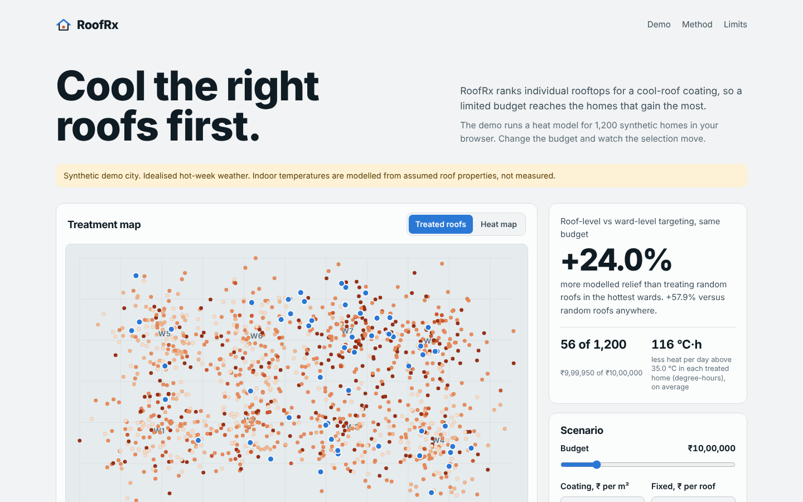
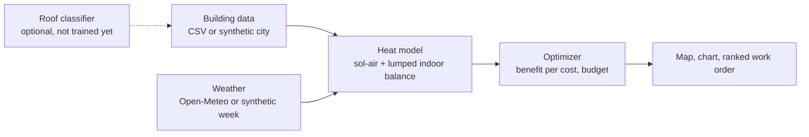

# RoofRx: roof-level cool-roof triage

ForgeHacks Online 2026 · Track: AI + Climate

RoofRx ranks individual rooftops for a cool-roof coating under a fixed budget, so a limited
programme reaches the homes that gain the most. It combines an hourly indoor-heat model, a
benefit-per-cost optimizer and, optionally, an image classifier that reads roof material from aerial crops.

**Live site:** https://madhuvidhyapad24-cloud.github.io/RoofRX-Climate-Tech/

**video demo:** https://drive.google.com/file/d/1RaKqIb2D_zPOnj_9_CKcXsr44Sk8SP3-/view?usp=sharing


## Problem

Roofs of metal, asbestos or bare concrete trap heat in homes that often have no air conditioning.
Cool-roof coatings can lower indoor temperatures by a few degrees, but budgets are small, so the
question is which roofs to treat first. Existing planning tools work at ward level. We did not find a
public tool that ranks individual rooftops, although our search was limited.

**Users:** city heat-action teams, NGOs running roof-coating drives, researchers choosing homes for field trials.

## How it works



1. **Heat model.** Per m² of footprint: `T_sa = T_out + α·I/h_out` and
   `C·dT_in/dt = U_roof(T_sa − T_in) + H(T_out − T_in)`, stepped hourly, before and after a coating.
   `C` and `H` grow with storeys, so single-storey homes get a larger roof share.
2. **Heat measure.** Default is *degree-hours*: how far indoor air is above a danger threshold, summed
   per day. The alternative counts whole hours above the threshold, which ties easily and can rank a barely
   hot roof level with a very hot one.
3. **Benefit and cost.** Benefit = heat avoided per day × people (the `occupants` column if given, otherwise
   roof area as a proxy). Cost = area × coating price + fixed cost per roof.
4. **Selection.** Roofs are taken in order of benefit per cost until the budget runs out. Ties break by indoor
   temperature drop, then larger roof area, so they do not favour whichever ward is listed first.
   This is a greedy heuristic, not a proven optimum.
5. **Baselines.** Ward-level: rank wards by mean heat, then treat random roofs inside the worst wards.
   Random: roofs in random order.

## Website (`docs/`, source in `web/`)

A single page that runs the same model in the browser: treatment map, budget / cost / threshold controls,
relief-versus-budget chart, ranked work order (copy or download CSV), CSV upload, light and dark themes,
phone layout. The **weather picker** loads real hourly data from Open-Meteo for seven Indian cities
(last 6 days plus today), and the page says clearly which weather and which buildings are in use.

### Put it online with GitHub Pages

1. Commit and push this repository, including the `docs/` folder.
2. On GitHub: **Settings → Pages → Build and deployment → Source: Deploy from a branch**,
   branch `main`, folder `/docs`, then Save.
3. After a minute the site is at `https://<your-username>.github.io/<repo-name>/`. Paste that link above and in the submission form.

Rebuild after editing anything in `web/`: `python web/build_site.py` (writes `docs/index.html`).
The page loads fonts from Google Fonts and weather from Open-Meteo, so it needs internet access.

## Honest status

| Part | Status |
|---|---|
| Heat model, optimizer, data loader, pipeline (Python) | Built, 28 unit tests pass |
| Website engine (JavaScript) | Matches the Python package exactly on heat, selected roofs and benefit for both heat measures (`python web/check_parity.py`) |
| Website in a real browser | Tested in Chromium: controls, map, chart, upload, download, light/dark, phone width |
| Live weather | Tested only against simulated Open-Meteo responses (success, errors, gaps, bad data). **Not yet run against the real service**; try it once after deploying |
| Streamlit app (`app.py`) | Logic smoke-tested against a stand-in for Streamlit. **Never rendered in real Streamlit.** Run it once locally |
| Classifier scripts (`classifier/`) | Written and syntax-checked only. **No model trained, no accuracy exists** |
| Python live weather (`roofrx/weather.py`) | Written, not tested against the real service |
| Real building data | **None used yet.** All results below are synthetic |
| Material parameters | **Assumed placeholders**, not literature values. Cite real ones before submitting |

## Results so far (synthetic buildings, synthetic weather, assumed parameters)

1,200 synthetic buildings in 8 wards, budget ₹10,00,000, ₹250 per m², threshold 35 °C
(`python -m roofrx.demo` and `python -m roofrx.demo --metric hours`):

| Heat measure | Roofs treated | Roof-level vs ward-level | Roof-level vs random |
|---|---|---|---|
| Degree-hours (default) | 56 | +24.9% | +57.4% |
| Whole hours | 86 | +10.4% | +21.4% |

The website shows slightly different baseline percentages for the same data (about +24% and +58%) because
its random draws come from a different generator.

These show the mechanism works. They are **not** an effect size for any real city: the synthetic wards were
built to differ in material and storey mix, and the size of the gain depends on that design.

Modelled mean indoor drop from a cool coating (assumed parameters): metal 1-storey ≈ 5.0 °C, concrete ≈ 2.9,
tile ≈ 2.2, other ≈ 3.9; 2-storey homes ≈ 1.4–3.8. Peak-hour drops are larger (up to ~14 °C for 1-storey
metal), which is probably high. This is a plausibility check against the 2–5 °C range often cited for cool
roofs, not validation.

## Run locally

```bash
pip install -r requirements.txt
python -m unittest discover -s tests -v     # Python tests
python web/check_parity.py                  # JS engine vs Python (needs node)
python -m roofrx.demo                       # synthetic demo -> results/
streamlit run app.py                        # Streamlit version of the tool
python web/build_site.py                    # rebuild docs/index.html
```

Own data: CSV with `building_id, ward, lat, lon, area_m2, material` plus optional `storeys` and `occupants`
(material = metal | concrete | tile | other; `occupants` replaces roof area as the number of people each roof helps).

## Classifier (optional, needs torch)

```bash
python classifier/prep_crops.py --tif scene.tif --footprints buildings.geojson
# put labelled crops into data/crops_split/{train,val}/<class>/ , hold out a different area for val
python classifier/train_classifier.py --data data/crops_split
python classifier/predict.py --model results/classifier.pt --crops data/crops/unlabeled --buildings in.csv
```

**Verify before claiming a classifier.** I could not confirm that the Open Cities AI Challenge labels include
roof *material* (my understanding is that they are mainly building footprints). If they do not, hand-label a few
hundred crops yourself, or drop the classifier claim and say material comes from a survey.

## Limitations

- Indoor temperatures are modelled, not measured; material parameters are assumed.
- Without an `occupants` column, roof area stands in for people.
- Storeys default to 1 when unknown, which overstates benefit for multi-storey buildings.
- Simple wall and ventilation term; no shading, insulation or occupant behaviour.
- A week of weather is a snapshot, not a hot-season average.
- The ward-level baseline is our own construction, not a reimplementation of any city tool.
- Synthetic results only until real buildings are loaded.


